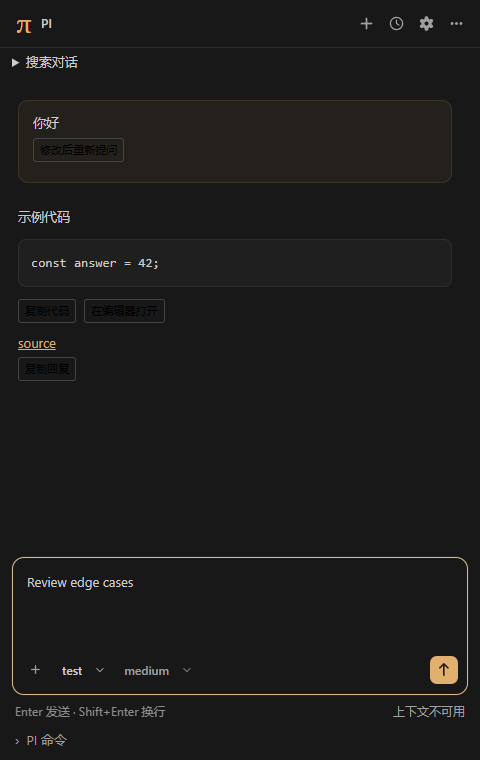
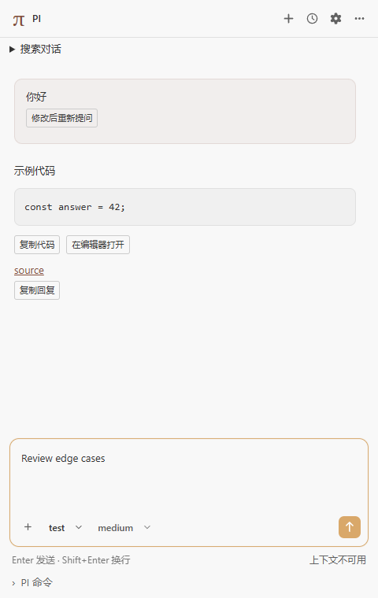

# PI

在 VS Code 侧边栏中使用本机已安装的 PI coding agent，完成聊天、工具调用和会话管理，无需为日常对话打开终端。

插件通过 `pi --mode rpc` 桥接本机 PI：界面与编辑器上下文由插件提供，推理、模型、工具、技能和会话仍由 PI 管理。交互组织参考 Codex / Claude Code 的侧栏方式，视觉优先参考 PI 自身的文本布局、消息配色和紧凑状态栏，并适配 VS Code 主题。

当前版本为 **1.0.2（正式版）**，扩展标识为 `SilasPaul.pi-agent-coding`。验证基线为 **Windows + PI 1.5.2**；首次上架完成前可通过 VSIX 安装。具体变更见 [更新记录](CHANGELOG.md)。

验收范围：当前仅验证 Windows 本地环境；真实模型生成、真实 MCP / 扩展交互和长会话成功压缩尚未完成端到端验收。模拟进程、浏览器夹具和扩展宿主测试不代表这些真实环境已经通过。完整说明见“范围与限制”。

## 界面

以下为真实浏览器运行 Webview 组件的夹具截图，使用模拟会话数据，并非原生 VS Code 或真实模型运行截图。





当前表单已使用 Web Awesome 统一按钮、输入框、下拉菜单和开关：输入区呈现附件、箭头发送按钮以及模型与思考强度；运行中默认发送后续消息，可在队列消息旁点击“引导”。设置和命令表单提供标签及说明。控件颜色跟随 VS Code 的暗色、浅色和高对比度主题，组件、样式与图标均随插件本地打包。

界面强调色参考 PI 官网的暖金与陶土色：暗色主题使用暖金色按钮和柔和选中底色，浅色主题使用陶土色；背景与正文继续适配编辑器，高对比度主题保留 VS Code 的可访问配色。

聊天正文、思考过程与输入区统一使用 VS Code 界面字号，不额外放大；状态提示略小一级，代码保留等宽字体。

PI 运行时显示点阵动画与 `Working`，结束后自动移除；启用系统“减少动态效果”时显示静态图标。

流式输出复用未变化的消息和工具节点，保留历史正文的文字选择、焦点和展开状态。侧栏可见时合并高频状态更新，隐藏期间暂停展示快照，重新打开时显示最新状态；隐藏侧栏仍会继续执行任务。

输入框下方不显示本地工作区路径；保留发送快捷键、用量和 PI 扩展状态，无扩展状态时不占位。

顶部的新建会话、历史会话、设置和更多操作使用图标按钮；悬停可查看中文提示。时钟图标打开历史，齿轮图标打开设置。

## 功能

| 能力         | 插件提供的操作                                                                                            |
| ------------ | --------------------------------------------------------------------------------------------------------- |
| 对话         | 流式 Markdown、代码块、可折叠思考、运行与错误状态                                                         |
| 工具结果     | 展示参数、文本和图片结果，通用处理未知工具名称；展示 PI edit 工具实际返回的修改差异                       |
| 编辑器上下文 | `@` 搜索工作区文件，`@open:` / `@current:` 选择文档；未保存内容、选区、诊断与资源管理器右键附件           |
| 输入效率     | `@` / `/` 键盘补全、最近 50 条输入、上下方向键回看、Ctrl/Cmd+R 搜索输入历史                               |
| 内容操作     | 文件引用跳转行列、复制回复和代码、在未保存编辑器打开代码、从用户消息分叉修改                              |
| 图片         | 文件选择、粘贴或拖入 PNG / JPEG / GIF / WebP；发送前检查模型图片能力                                      |
| 模型与命令   | 发现并选择 PI 模型和思考强度；通过 `/` 菜单选择 PI 发现的技能、提示模板和扩展命令                         |
| 运行中交互   | 补充指示、后续消息、队列展示、清空并恢复到输入框、停止全部                                                |
| 会话与历史   | 恢复上次工作区会话、筛选索引、搜索当前对话及 PI 完整历史、新建、重命名、只读历史树、分叉、复制和导出 HTML |
| 工作导航     | 成功 write / edit 工具的文件导航、打开 VS Code 源代码管理、查看 PI 技能与模板来源                         |
| 快捷操作     | `!` 独立命令、队列逐条/全部处理、轮换模型与思考强度；后台完成、失败和等待交互通知                         |
| 上下文与重试 | token、费用和上下文占用；自动压缩设置、手动压缩、自动重试设置与取消                                       |
| PI 扩展交互  | 选择、确认、输入和编辑对话框；文本状态、widget、标题和输入框更新                                          |
| 独立命令     | 经 PI 执行 shell 命令、查看输出、取消执行，选择是否加入后续模型上下文                                     |

各项操作是否可用取决于所安装 PI 的 RPC 能力、模型和扩展配置。真实 MCP 环境与长会话成功压缩尚未完成验收。

在聊天输入框输入 `/`，可选择 PI 发现的技能、提示模板、扩展命令，以及以下插件快捷操作。方向键选择，`Tab` / `Enter` 补全，再按 `Enter` 执行。

| 快捷命令 | 操作 |
| --- | --- |
| `/new` | 新建会话；当前正在运行时先停止全部任务 |
| `/compact [摘要要求]` | 手动压缩上下文，例如 `/compact 保留文件名和待办`；需等待当前任务完成 |
| `/model` | 从 PI 返回的可用模型中选择 |
| `/thinking` | 从 PI 返回的可用思考强度中选择 |
| `/resume` | 打开当前工作区的会话历史；也可从历史面板选择会话文件 |
| `/name [名称]` | 重命名当前会话；省略名称时弹出输入框 |
| `/fork` | 选择用户消息并分叉，不回滚文件 |
| `/clone` | 复制当前会话，不回滚文件 |
| `/tree` | 只读浏览会话历史树 |
| `/export` | 导出对话为 HTML |
| `/settings` | 打开侧栏内的设置面板 |
| `/stop` | 清空队列并停止当前任务 |

这些快捷操作复用插件已有的服务与 PI RPC，不作为普通消息交给模型。除 `/compact` 和 `/name` 外不接收参数；除 `/stop` 保留已有附件并直接停止外，其他快捷操作不接收附件。失败或取消对话框时保留命令草稿。PI 已发现的同名命令优先，保持现有技能、模板与扩展的行为；其余插件快捷操作在补全列表中优先显示。

`/model`、`/thinking`、`/resume`、`/settings` 打开侧栏已有的选择器或面板。`/stop` 在压缩等待或队列重排期间仍可输入执行，其完成通知不会清除其他待发送草稿。这里的快捷操作只覆盖插件已实现的 RPC 与界面能力，例如 `/tree` 仍是只读浏览，不提供 PI 终端中的分支切换。

## 安装与快速开始

### 1. 准备环境

- 本机已安装并配置 PI，已有可用模型；首次登录和供应商配置需在 PI 自身完成。
- VS Code 满足扩展声明的 `1.106.0` 或更高版本，当前实测版本为 `1.145.3`。
- 打开一个本地文件夹，并在 VS Code 中信任该工作区。
- 使用 JS 入口或脚本启动器时，本机需有能运行该 PI 版本的 Node.js；可通过 `pi.nodePath` 指定。

当前仅验证 Windows 本地扩展宿主。远程、虚拟和未受信任工作区不启动 PI；macOS / Linux 尚未实测。

### 2. 安装扩展

上架后，可在扩展视图中搜索 `@id:SilasPaul.pi-agent-coding`，核对发布者为 **SilasPaul** 后安装；也可通过命令 `code --install-extension SilasPaul.pi-agent-coding` 安装。首次上架前请使用下面的 VSIX 方式。

打开 VS Code 命令面板（Windows：`Ctrl+Shift+P`），运行 **Extensions: Install from VSIX…**，选择 `pi-agent-coding-1.0.2.vsix`。

如果从源码开始，在仓库根目录执行以下命令生成安装包：

```powershell
npm ci
npm run package
```

安装包生成于仓库根目录，文件名随 `package.json` 中的版本变化。也可以用 VS Code CLI 安装已生成的包：

```powershell
code --install-extension .\pi-agent-coding-1.0.2.vsix
```

### 3. 连接 PI

1. 运行 **PI: Open Sidebar**，默认在右侧辅助侧边栏打开 PI。
2. 插件在 VS Code 启动完成后激活并自动连接本机 PI，无需点击连接；多根工作区会提示选择本次 PI 的工作目录。仅在受信任的本地文件工作区自动连接。
3. 如果找不到 PI，插件会提示 **打开安装说明** 或 **配置 PI 路径**。按官方说明在本机安装 PI，完成 PI 自身的登录或模型配置后重启 VS Code；如果已经安装，在用户设置中填写 `pi.executablePath` 后运行 **PI: Reconnect**。插件只提供安装引导，不自动执行安装命令。
4. 输入问题并按 `Enter` 发送；`Shift+Enter` 换行，中文输入法选字期间的 `Enter` 不会发送。

插件会启动一个独立的 PI RPC 进程，不会接管已有终端中的 PI 进程。模型、技能和工具由该进程按 PI 原有配置加载，插件不额外保存供应商凭证。

## 配置

在 VS Code 设置中搜索 `@ext:SilasPaul.pi-agent-coding`，或从侧栏的 **⋯ → 插件设置** 进入。

| 设置                   | 默认值                      | 说明                                                                           |
| ---------------------- | --------------------------- | ------------------------------------------------------------------------------ |
| `pi.executablePath`    | 空，自动从 `PATH` 查找      | 本机 PI 入口的绝对路径；支持可执行文件、JS 入口及可识别的官方 / npm 脚本启动器 |
| `pi.nodePath`          | 空，使用 `PATH` 中的 `node` | 运行 PI JS 入口时使用的 Node.js 可执行文件                                     |
| `pi.requestTimeoutMs`  | `10000`                     | 普通控制请求的等待时间，单位毫秒                                               |
| `pi.startupTimeoutMs`  | `60000`                     | PI 版本检测与启动握手的等待时间，单位毫秒                                      |
| `pi.shutdownTimeoutMs` | `5000`                      | 断开时等待 PI 正常退出的时间，超时后清理本次启动的进程树                       |

路径设置为机器级设置，请配置在 **用户设置**，不要写入仓库的 `.vscode/settings.json`。超时设置最小为 `1000` 毫秒；模型生成、压缩等长操作不使用普通控制请求的短超时。

以下仅为 Windows 路径写法示例，请将路径替换为自己的实际安装位置：

```json
{
  "pi.executablePath": "C:\\path\\to\\pi.ps1",
  "pi.nodePath": "C:\\Program Files\\nodejs\\node.exe",
  "pi.requestTimeoutMs": 10000,
  "pi.startupTimeoutMs": 60000,
  "pi.shutdownTimeoutMs": 5000
}
```

官方 `.ps1` / `.cmd` 启动器会优先解析到对应 JS 入口；插件不会执行任意自定义 shell 启动脚本。更改设置后，通过 **PI: Reconnect** 或侧栏重新连接使其生效。

## 日常使用

### 附加代码与图片

选中文本后，在编辑器右键菜单运行 **PI: Attach Selection**，或从命令面板运行同名命令。插件读取当前编辑器内容，因此未保存修改也能发送。

点击输入区的 **＋** 图标添加 UTF-8 文本或图片；模型和思考强度位于它右侧的同一行。也可以在输入框粘贴图片，或将图片拖入侧栏。发送前可移除附件。切换到不支持图片的模型时，插件会阻止携图发送并提示处理。

在输入框输入 `@` 搜索当前工作区路径，输入 `@open:` 选择已打开文档，`@current:` 选择当前编辑器文档。用上下键选择、Enter 或 Tab 确认、Escape 关闭；文件搜索仅枚举路径，明确选择后才读取内容。已打开的未保存修改和未命名文档使用编辑器当前文本。文件搜索遵循 `files.exclude` / `search.exclude` 的布尔排除规则，跳过 `.git` 和 `node_modules`；插件最多枚举 2,000 个初始路径、展示 30 个候选，大工程请输入更完整文件名以触发定向搜索，不保证完整模糊检索。

资源管理器选中文件后右键 **PI: 添加到 PI**，可一次附加多个文件。通过 **⋯ → 选择诊断作为附件** 搜索并选择一条诊断；不会自动收集工程诊断或文件正文。聊天中的 Markdown 文件链接（例如 `src/main.ts:12:3`、`main.ts#L12`）和附件名称可以跳转到文件；只允许当前工作区或用户已明确附加的文件。

回复和代码块旁提供复制按钮；**在编辑器打开** 创建未保存文档，供继续编辑。输入框在起始位置按上方向键回看输入历史，再按下方向键返回草稿；Ctrl/Cmd+R 搜索最近输入，最多保存 50 条，每条不超过 100,000 字符。历史仅保存在侧栏状态中，不保证跨窗口永久保存。

### 模型、思考强度与斜杠命令

点击底部模型名称或思考强度，在对应按钮旁展开的侧栏下拉菜单中选择 PI 返回的可用选项。下拉选项以背景高亮表示选中状态，不显示对勾。菜单支持键盘导航和 Escape 关闭。在输入框键入 `/` 可筛选 PI 发现的技能、提示模板和扩展命令，选择后补充参数并发送，内容的解释与展开由 PI 完成。

菜单展示 PI 通过 RPC 发现的命令及前述插件快捷操作，不等同于 PI 终端界面的全部内置命令。需要交互登录、终端设置或自定义终端 UI 的操作仍应在 PI 自身完成。

`/` 候选支持上下键、Enter / Tab 和 Escape。通过 **⋯ → 技能与模板来源** 查看 PI 返回的来源信息；选择有本地来源路径的条目可在编辑器查看。PI 未返回路径的资源只显示已有信息。侧栏获得焦点时，`Alt+Shift+M` 轮换 PI 模型，`Alt+Shift+T` 轮换思考强度；也可从更多菜单或命令面板操作。

### 运行中发送与停止

- **默认发送**：点击箭头或按 Enter，空闲时开始对话；运行中将消息加入 PI 的 follow-up 队列，作为后续消息，无需选择发送方式。
- **引导**：点击某条后续消息旁的“引导”，将它转为补充指示，由 PI 在当前工具执行结束后的可处理时机接收；不会中止当前任务。入队成功不代表模型已经处理。
- **清空并恢复到输入框**：清空队列，并将返回的队列文本追加到草稿，便于修改后重新发送。
- **停止全部**：先清空队列，再中止当前运行，避免停止后又执行已排队的消息。

点击侧栏顶部的 **设置 → 队列处理（高级）**，可分别设置后续队列和引导队列的 **逐条处理** 或 **一次处理全部**。这两项保留 PI 的队列批量处理能力，仅决定每次取出多少条消息，不会改变默认发送为后续消息的交互；实际处理时机由 PI 决定。高级区域默认折叠，设置未知时显示未知，不推算默认值。

**引导限制（插件）**：PI 1.5.2 没有单条队列转换 RPC，插件使用清空队列并重新提交的方式实现，仅适用于未被输入扩展改变的纯文本队列。插件会禁用已知含图片、斜杠命令、相同文本或来源不明的队列，并说明原因。RPC 只回传队列文本，无法识别输入扩展在保留原文时自动添加的图片；此类队列不支持“引导”，请勿使用该按钮，以免丢失扩展添加的内容。重新提交会再次运行输入扩展，可能改变内容或重复产生副作用。

重排期间不能发送、清空或切换会话，停止仍可用。目标已经被 PI 消费时不会重复发送它。重排不是原子操作；如请求失败，不自动重试结果不确定的消息，确定尚未重新提交的文本会追加回草稿，请检查错误提示、对话和队列后处理。若点击停止时仍有未确认的引导提交，插件会先尝试清空队列和中止运行，再断开本窗口的 PI 进程，防止在途输入稍后继续执行；需要重新连接。

### 会话与历史

顶部 **＋** 新建会话，**历史** 在按钮下方展开当前工作区曾通过插件打开的会话，点击记录即可切换；点击外部或按 Escape 关闭列表。**⋯** 中可重命名、打开其他 PI `.jsonl` 会话文件、分叉、复制或导出 HTML。

历史列表使用插件自己的工作区索引，不会扫描 PI 的全局会话库。历史树用于只读浏览，选择节点不会切换对话。分叉与复制仅改变对话上下文，**不会撤销 PI 已经写入的文件**。

连接后自动恢复当前工作区索引中最近打开的会话；恢复失败会显示错误并保留可用连接。历史弹层可按名称、ID 或路径筛选。聊天顶部 **搜索对话** 只筛选当前可见消息；**搜索 PI 完整历史** 通过 `get_entries` 搜索压缩前及其他分支的文本，最多列出 100 条匹配，每条最多预览 4,000 字符，不切换历史节点。

用户消息旁的 **修改后重新提问** 使用 PI 分叉，当前分支回到该消息之前，后续回复不再显示；原问题会立即放回输入框并聚焦，修改后自行发送。从第一条问题分叉时，当前分支会暂时显示空对话。后续信息刷新失败不会丢失已恢复的草稿。若压缩等原因使可见消息无法准确对应 PI 分叉点，请改用更多菜单里的分叉操作。**本次对话修改的文件** 只列出当前加载消息中已观察到的成功 `write` / `edit` 路径，不声称覆盖 shell、MCP 或外部进程的全部修改；**打开源代码管理** 使用 VS Code 自身的 Git/SCM 视图。

点击历史记录右侧的移除按钮可将其从当前工作区历史列表移除，列表会立即刷新。此操作仅移除插件索引，**保留 PI 的 `.jsonl` 会话文件**，也不会中断当前对话；仍可通过“打开其他 PI 会话文件…”重新打开。移除当前会话记录后，后续重命名、刷新或重新打开该会话时，记录可能重新加入历史。

### 上下文、重试与独立命令

底部状态行显示 PI 返回的 token、费用和上下文占用；暂不可用或尚未更新的上下文会显示相应提示。点击这行用量信息可发起 **手动压缩上下文**，也可用 Tab 聚焦后按 Enter 或空格打开；在弹出的输入框中可填写摘要需要保留的信息，留空确认使用 PI 默认策略，按 Escape 取消。未连接、任务运行或压缩期间入口不可用，压缩时显示“正在压缩…”，完成后刷新用量，失败时显示 PI 返回的错误。压缩是整理上下文，不等于删除指定问答。点击侧栏顶部的 **设置** 打开面板，可调整自动压缩、自动重试或发起手动压缩；点击关闭、面板外部或按 Escape 关闭。插件不叠加自己的模型请求重试循环。

展开 **Bash 命令（由 PI 执行）** 可通过 PI 的 bash RPC 执行独立命令，例如 `git status` 或 `echo PI`。自然语言问题（例如“你好”）请在上方聊天输入框发送；Bash 命令面板会将输入直接作为命令执行。默认情况下，其输出会在下一次模型请求时加入上下文；勾选 **不加入上下文** 可排除本次输出。该面板不提供持续交互式终端。

面板中的 **命令退出码** 属于本次 Bash 命令；`127` 通常表示未找到命令，不代表 PI 进程退出。检查命令名称及 PI 使用的 Bash 环境；若要与 AI 对话，改用聊天输入框。

也可以在聊天输入框以 `!` 开头输入命令，例如 `!git status`，发送后自动展开命令面板，取消仍使用 PI 的 bash 取消 RPC。此快捷方式不接收附件；命令最多 100,000 字符（插件限制）。侧栏隐藏或 VS Code 窗口不在前台时，插件在任务结束、失败或等待扩展交互时发送 VS Code 通知；当前前台侧栏不会重复通知。

### 在右侧或左侧显示 PI

PI 默认注册在右侧辅助侧边栏，可与左侧文件资源管理器同时显示。右侧被隐藏时，运行 **View: Toggle Secondary Side Bar Visibility**，再运行 **PI: Open Sidebar**。

更新已有安装后，VS Code 可能保留之前的左侧布局。右键 PI 视图标题，选择 **Move View → Secondary Side Bar（移动视图 → 辅助侧边栏）**；也可将 PI 视图拖到右侧。需要放回左侧时选择 **Primary Side Bar（主侧边栏）**。移动的是同一个视图，会话和 PI 进程继续使用。

### 隐藏侧栏与断开连接

隐藏侧栏不会停止 PI 的当前任务。通过 **⋯ → 断开** 或关闭扩展会清理插件创建的 PI 进程；异常断开后需主动重新连接，插件不会自动重放上次消息。

发送尚未确认时断开会保留输入草稿，重新连接后可自行检查对话并决定是否再次发送。重命名、压缩和导出对话框打开期间若切换会话或重新连接，插件会提示重新操作，避免操作落到其他会话；旧连接或旧会话的延迟刷新结果不会覆盖当前数据。PI 取消新建、分叉或复制时，相关快捷命令也会保留在输入框。

## 常用命令

| 命令面板名称         | 命令 ID              | 用途                         |
| -------------------- | -------------------- | ---------------------------- |
| PI: Open Sidebar     | `pi.open`            | 打开 PI 侧栏                 |
| PI: Attach Selection | `pi.attachSelection` | 将当前选区添加为附件         |
| PI: Reconnect        | `pi.reconnect`       | 按当前配置重新连接本机 PI    |
| PI: 添加到 PI        | `pi.attachFiles`     | 附加资源管理器明确选中的文件 |
| PI: 轮换模型         | `pi.cycleModel`      | 调用 PI cycle_model          |
| PI: 轮换思考强度     | `pi.cycleThinking`   | 调用 PI cycle_thinking_level |

## 常见问题

| 情况                               | 处理方式                                                                                                                          |
| ---------------------------------- | --------------------------------------------------------------------------------------------------------------------------------- |
| 找不到 PI                          | 点击提示中的“打开安装说明”安装本机 PI；安装后重启 VS Code 以更新环境变量，或通过“配置 PI 路径”设置 `pi.executablePath` 后重新连接 |
| 提示启动器无法识别                 | 改用 PI 官方启动器、JS 入口或可执行文件；自定义 shell 包装脚本不会直接执行                                                        |
| 提示 Node 不存在或启动失败         | 检查 `pi.nodePath`；JS 启动器需要可运行该 PI 版本的本机 Node.js                                                                   |
| 无工作区、工作区未信任或是远程窗口 | 打开并信任本地文件夹后连接；首版不支持远程宿主                                                                                    |
| 登录失败、模型不可用               | 在 PI 自身完成登录或模型配置，再重新连接；插件不提供凭证管理                                                                      |
| 图片发送被阻止                     | 选择 PI 报告支持图片输入的模型，或移除图片；同时检查格式与大小限制                                                                |
| 历史中找不到终端创建的会话         | 使用 **⋯ → 打开 PI 会话文件** 手动打开 `.jsonl` 文件                                                                              |
| 压缩提示会话内容较少               | PI 返回 `Nothing to compact (session too small)` 时，插件显示无需压缩的普通提示，可继续对话；不按上下文百分比推算压缩门槛         |
| 连接超时、进程退出或输出协议错误   | 查看侧栏错误及 **输出 → PI** 中的启动诊断，修正路径、Node 或 PI 配置后主动重连                                                    |

## 范围与限制

插件只负责 UI 桥接，不打包 PI 智能体运行库，不直接调用模型 API，不安装 PI，也不接管 PI 的模型和工具配置。

- **修改结果**：工具差异来自 PI 实际执行后的返回结果，不提供逐块审批、文件快照或自动回滚。
- **工具与 MCP**：由 PI 自己加载和执行；插件通用展示工具结果，不建立第二套 MCP 客户端。真实 MCP / 扩展交互环境尚未验收。
- **终端能力**：不桥接终端主题同步、自定义终端 UI 或交互登录。
- **兼容性**：PI 1.5.2 是验证基线，不代表所有 PI 版本都兼容；macOS / Linux、完整辅助功能矩阵和长会话成功压缩尚未实测。

插件自身的输入与展示限制如下，不代表 PI 或模型服务的限制：

| 项目                    | 限制                                                                 |
| ----------------------- | -------------------------------------------------------------------- |
| 文件 / 单张图片         | 每个不超过 5 MiB                                                     |
| 图片合计                | 不超过 15 MiB                                                        |
| 附件数量                | 最多 100 个                                                          |
| 工具文本 / 修改差异预览 | 每个文本块或差异最多 30,000 字符                                     |
| 独立命令输出预览        | 保留末尾 200,000 字符，插件截断会标注；PI 返回完整输出路径时同时展示 |

## 本地开发

开发验证环境为 Node.js `24.18.0`、npm `11.16.0`。在仓库根目录运行：

```powershell
npm ci
npm run compile
```

随后在 VS Code 中按 `F5`，选择 **Run PI Extension** 启动扩展开发宿主。可用 `npm run watch` 监听源码并重新构建。

| 命令                       | 作用                                                   |
| -------------------------- | ------------------------------------------------------ |
| `npm run check`            | TypeScript 类型检查                                    |
| `npm run validate`         | 类型检查、单元测试和模拟 PI 进程集成测试               |
| `npm test`                 | 单元测试                                               |
| `npm run test:integration` | 模拟 PI 子进程的集成测试                               |
| `npm run test:vscode`      | 真实 VS Code 扩展宿主测试，使用模拟 PI                 |
| `npm run test:webview`     | 真实浏览器夹具，检查控件交互及 12 种尺寸/主题/缩放组合 |
| `npm run compile`          | 构建扩展宿主与 Webview 产物                            |
| `npm run package`          | 构建并生成 VSIX                                        |

`test:vscode` 使用隔离的测试配置、扩展目录和临时工作区；Windows 下优先使用本机 VS Code，也可通过 `PI_TEST_VSCODE` 指定可执行文件。没有可用本机路径时，测试工具可能下载 VS Code。测试宿主中的模拟 PI 通过不代表真实模型或 MCP 验收通过。

`test:webview` 使用现有 Playwright Core，本机 Windows 优先查找 Edge / Chrome，也可通过 `PI_TEST_BROWSER` 指定浏览器路径。截图输出到系统临时目录，属于浏览器夹具，不是原生 VS Code 截图。自动测试覆盖单元行为、模拟进程和原生 VS Code API；真实模型生成、真实扩展交互及完整历史数据尚未端到端验收。

2026-11-12 另在专用临时目录完成真实 PI 1.5.2 的基础 RPC 冒烟验证：连接、会话读取与新建、模型与思考强度发现、命令发现、统计、重命名、Bash、历史树与分叉点查询、停止，以及空会话导出拒绝和无需压缩提示。该验证关闭扩展、MCP、技能与模板发现，使用离线启动模式，未调用模型，不代表真实生成、扩展交互或长会话成功压缩已通过。

`npm run package` 和 VS Code 发布前钩子会先执行 `validate`，任一检查失败即停止。构建会根据依赖生成 `THIRD_PARTY_NOTICES.txt` 并随包分发，缺少依赖许可全文时会报错。VS Code 宿主和浏览器测试需在发布前另行运行。安装包不会随源码构建自动更新，需运行 `npm run package` 重新生成 VSIX。

核心代码分为三部分：`webview/` 提供界面，`src/pi/` 管理启动与 JSONL RPC，`src/features/` 连接编辑器、附件、会话和扩展交互。Webview 无法直接读取本机文件、启动进程或连接模型供应商。

## 隐私与反馈

消息与所选附件交给本机 PI；PI 可能按你的供应商配置将内容发送到外部模型服务。插件不另外保存供应商凭证，也不包含分析遥测。会话索引、草稿及 PI 会话的存储范围见 [隐私说明](PRIVACY.md)。

问题和建议请提交到本仓库的 [Issues](https://github.com/1521620063/pi-agent-coding/issues)，附上扩展、VS Code、PI 版本及复现步骤。请在分享诊断前移除凭证、私人路径和会话内容。

## 许可证

[MIT](LICENSE)。本仓库许可证适用于插件代码；打包依赖的许可与版权声明见 [第三方许可](THIRD_PARTY_NOTICES.txt)。本机安装的 PI 及相关服务遵循其各自的许可与条款。
